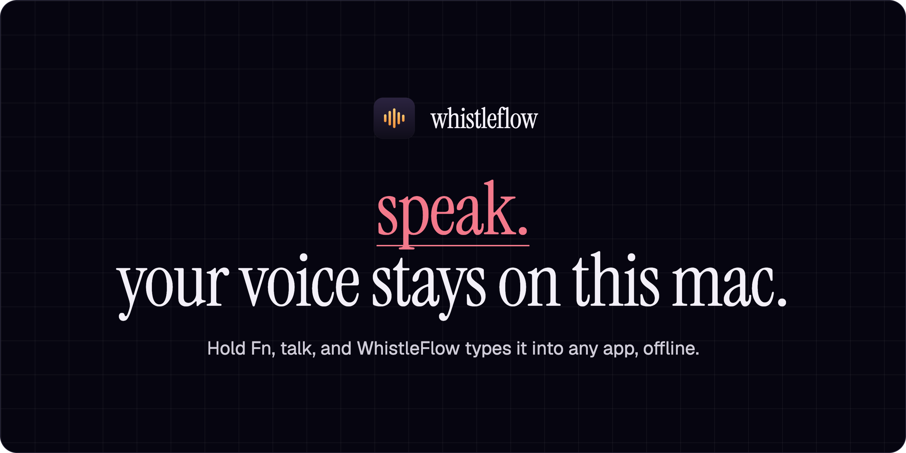
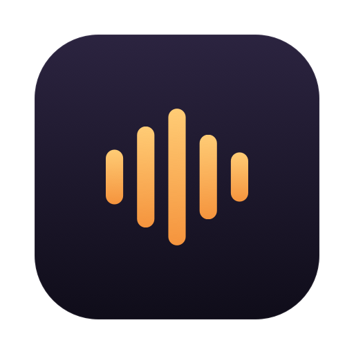

  

  <a href="https://github.com/ronakmunjapara/WhistleFlow/releases/latest/download/WhistleFlow.dmg"><b>Download for Mac</b></a>
  &nbsp;&nbsp;|&nbsp;&nbsp;
  Free for the first 100 users
  &nbsp;&nbsp;|&nbsp;&nbsp;
  macOS 26 on Apple silicon

---

## Hold Fn. Talk. Let go.

WhistleFlow lives in your menu bar. Hold **Fn** anywhere you can type, say what you mean, and let go. The text is pasted where your cursor is, in Mail, Slack, Notes, your editor or the terminal.

1. **Hold Fn.** A small pill at the bottom of the screen shows your voice level.
2. **Let go.** The model transcribes on your Mac. The pill turns to a spinner.
3. **Done.** The sentence lands at your cursor, and your clipboard is put back.

## Your voice stays on this Mac

Cloud dictation uploads every sentence to a server you don't run. WhistleFlow's path is one hop: **mic, then the model on your Mac, then text in your app.** It never opens a network connection, so it works on a plane, and nothing you say is stored anywhere else.

## Lighter and quicker than Whisper

The lightweight AI model inside WhistleFlow, measured against OpenAI Whisper base:

| | WhistleFlow's model | Whisper base |
| --- | ---: | ---: |
| Time to the first word | **11.1 ms** | 73.2 ms |
| Decoding speed | **1,319 tokens/s** | 266 tokens/s |
| Size on disk | **16.9 MB** | 145.3 MB |

Published benchmark of the model inside WhistleFlow: 10 s of audio on an Apple M4 Pro, each engine at its defaults.

## What you get

| | |
| --- | --- |
| **Languages** | English, German, French, Spanish, Italian, Dutch, Polish, detected as you speak |
| **Runs on** | Your Mac's CPU. No GPU, no internet, no account |
| **Download** | 16 MB, with the model built in |
| **Needs** | macOS 26 on Apple silicon (M1 or later) |
| **Price** | Free for the first 100 users |

## Install

1. [Download WhistleFlow.dmg](https://github.com/ronakmunjapara/WhistleFlow/releases/latest/download/WhistleFlow.dmg), open it, and drag **WhistleFlow** into **Applications**.
2. Open WhistleFlow. The first time, macOS may say it can't verify the developer. Right-click the app, choose **Open**, then **Open** again.
3. A short setup guide walks you through:
   - **Microphone**, so it can hear you while you hold Fn
   - **Accessibility**, so it can notice the Fn key and paste the text
   - **Press 🌐 key to: Do Nothing**, so Fn doesn't open the emoji picker
   - **A test dictation**, to confirm it works
4. Hold **Fn** in any app and talk.

You can reopen the guide anytime from the menu bar icon, under **Setup Guide…**

## Questions

**Does it need the internet?** No. Everything, including the model, runs on your Mac.

**Which apps does it work in?** Any app that accepts a paste: browsers, Mail, Slack, Notes, Word, code editors, the terminal.

**The Accessibility switch is on, but setup isn't ticked.** Click **Reset and ask again** in the setup guide, then turn WhistleFlow on once more.

**How do I quit it?** Click the waveform icon in the menu bar and choose **Quit WhistleFlow**.

---

   
  <b>WhistleFlow</b>, made by Ronak Munjapara. 
  © 2026 Ronak Munjapara.

